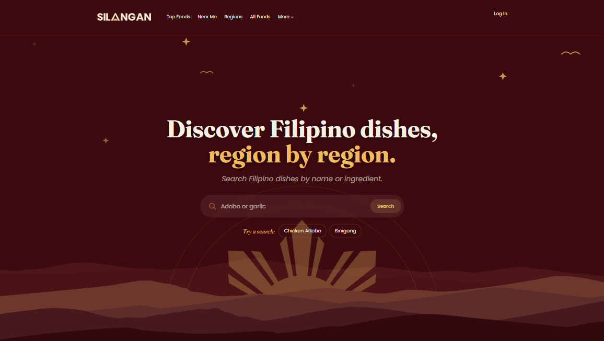

# Silangan

A responsive website for exploring Filipino food: top dishes, regional discoveries, recipes and more.

*Live site:* [silangan.vercel.app](https://silangan.vercel.app/)

## About

Silangan is a multi-page website made for BSIT Web Systems and Technologies (IT Elec 2-B). It celebrates Filipino food and culture by helping visitors discover popular dishes and recipes, learn about regional specialties, find places to eat near them, and explore a map of the Philippines. This project is for educational purposes only and is not a commercial website.

## Features

- Search for Filipino dishes by name or ingredient
- Multi-page site with a shared navbar and footer
- Fully responsive layout for desktop, tablet and mobile
- Hamburger menu on small screens
- Swipeable card rows on tablets and phones
- Custom 404 page

## Pages

- Home
- Top Foods
- Near Me
- Regions
- All Foods
- Recipes
- Map
- Random Food
- Log In, Sign Up and Forgot Password (account features are unavailable in this static version)
- 404 Not Found

## Built with

- HTML
- CSS
- JavaScript (mobile menu)
- Deployed on Vercel

## Run it locally

1. Download or clone this repository.
2. Open index.html in your browser.

Keep the folder structure (css, js, assets) as it is, or the styles and images won't load.

## Author

David Gregorio  
BSIT 2-B