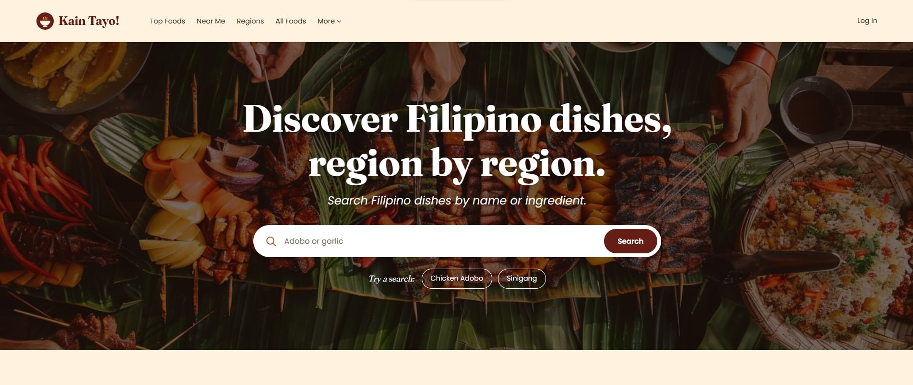

# Kain Tayo!

A responsive website for exploring Filipino food: top dishes, regional discoveries, recipes and more.

*Live site:* [kain-tayo-ph.vercel.app](https://kain-tayo-ph.vercel.app/)

## About

Kain Tayo! ("Let's eat!") is a multi-page website made for BSIT Web Systems & Technologies (IT Elec 2-B). It helps visitors discover Filipino dishes, find where to eat, and learn about food from different regions.

## Features

- Multi-page site with a shared navbar and footer
- Fully responsive layout for desktop, tablet and mobile
- Hamburger menu on small screens
- Swipeable card rows on tablets and phones

## Pages

- Home
- Top Foods
- Near Me
- Regions
- Foods
- Recipes
- Map
- Random
- Log In

## Built with

- HTML
- CSS
- JavaScript (mobile menu)
- Deployed on Vercel

## Run it locally

1. Download or clone this repository.
2. Open index.html in your browser.

Keep the folder structure (css, js, assets) as it is, or the styles and images won't load.

## Author

David Gregorio
BSIT 2-B